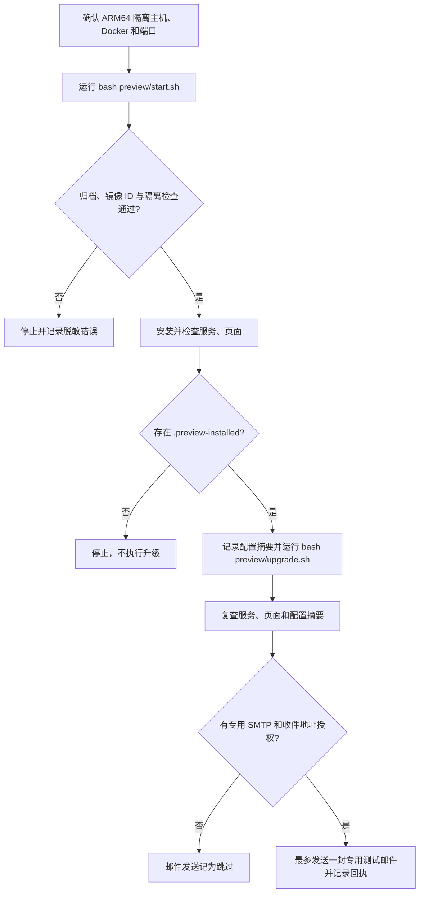

# 通知预览包同事测试指南

这份指南用于在隔离环境里检查通知预览包的全新安装、升级保留和启动状态。目标是让测试同事能复现安装结果，同时避免碰到现有产品环境或向真实邮件服务器发信。

## 本次测试包是什么

本预览包从固定提交构建，包含 installer、ThingsPanel 后端、前端、Core 和 SMTP 插件。本轮改动只在五个仓库的候选 feature 分支上；原始 `main`/`master` 分支保持不动。候选分支名为 `codex/notification-preview-20261010`、`codex/notification-installer-preview-20261010` 和 `codex/notification-smtp-installer-preview-20261010`。Core 仓库是私有仓库，同事需要已有仓库访问权限才能查看源码或自行重建。

构建器要求四个应用源码仓库处于指定提交且工作区干净；Core 工作区里的未提交内容和未跟踪的新物模型 CLI、gateway 不会进入包。本轮交付的是 Linux ARM64 本地离线包，镜像放在 `images.d/*.tar.gz`，每个镜像单独一个压缩归档，不需要把归档展开到磁盘。`offline-images.lock.json` 记录源提交、目标架构、镜像 ID、归档 SHA-256、Compose 镜像清单和物模型迁移文件 SHA-256。

本轮已实际构建的包只针对 Linux ARM64。Windows 和 Linux amd64 包尚未实测，也没有可交付的 amd64 包。构建器接受 `--arch amd64`，这只表示可在相应 Docker 目标机器上尝试构建，不代表 amd64 已构建或验收通过。

## 测试前准备

1. 使用专门的 Linux ARM64 测试主机或隔离虚拟机，安装可用的 Docker Engine 和 Docker Compose v2（Compose 至少 2.30），并确认 Docker 能运行 Linux ARM64 容器。运行预览入口还需要 Python 3.12。
2. 获取本轮生成的完整预览目录，保持其目录结构和全部 `images.d/*.tar.gz` 文件完整。不要把包放进已有 ThingsPanel 安装目录。
3. 确认预览包所在机器没有在使用下列本机端口：28080、29999、25555、26379、21883、28082、28083、20502、20503、29090、29091、28000、23000、29406、29407。安装器会把服务端口绑定到 `127.0.0.1`；这些端口只供本机访问。
4. 测试前不要在这台主机上安装生产版，也不要把生产主分支拿来试装或升级。预览包使用固定 Compose project `tp-notification-preview-20261010` 和独立数据卷；它要求全新资源，发现同名容器或卷会停止。

如果 Docker、端口、平台或包结构不满足条件，记录具体报错并停止，不要清理或重命名其他 Compose 项目来绕过隔离检查。

## 全新安装

在包根目录执行（即同时包含 `docker-compose.yml` 和 `preview/` 的目录）：

```bash
bash preview/start.sh
```

这是完整入口。脚本先验证 Compose 隔离、卷和网络归属、bind mount 路径、loopback 端口、镜像归档集合及每个归档的 SHA-256；随后逐个 `docker load`，再核对本地镜像 ID 和架构，最后才调用包内 `install.bash` 完成安装。不要直接调用 `install.bash` 跳过这些检查。

安装后检查：

- 包根目录（含 `docker-compose.yml` 和 `preview/` 的目录）出现 `.preview-installed`，表示安装脚本成功返回；它本身不等同于应用和通知功能验收通过。
- 在包根目录运行 `docker compose ps`，确认主要服务为运行状态，健康检查为 healthy。重点查看 `notification-setup`、`notification-smtp-tls`、`notification-smtp`、Core、Postgres 和 Caddy 相关服务。
- 在测试主机本地打开 `http://127.0.0.1:28080`，确认 ThingsPanel 页面可访问并完成一次基本登录/页面检查。记录页面表现和服务状态；HTTP 可访问不能单独证明邮件发送成功。
- 若健康检查失败，保存服务名、状态和脱敏后的错误片段。不要把 `.env`、`data/notification`、完整容器环境、证书、token 或密码发到群里或工单里。

本轮预览包会预装 SMTP 插件；插件健康状态不代表默认通知策略或单独优先级已自动配置。初始 SMTP 出站服务器 allowlist 为空，发送应 fail-closed，不会配置或触达外部邮件服务器。全新安装不会自动创建邮件账户、租户授权或告警源凭据；新租户的数据接入 reader allowlist、source 和 projection 需要单独的内部验证。

## 升级与配置保留

只对刚才通过 `preview/start.sh` 成功安装、且包根目录存在 `.preview-installed` 的预览环境执行升级。该标记由 `preview/upgrade.sh` wrapper 在升级前检查；主升级器本身不负责这个预览门槛。不要对生产安装或原始 `main`/`master` 实例试装、升级。

升级前，在包目录记录必要配置文件的 SHA-256（只记录文件名和摘要，不复制文件内容）：

```bash
shasum -a 256 data/notification/smtp.env \
  data/notification/core.env \
  data/notification/plugin-token \
  data/notification/keyring.json \
  data/notification/tls/ca.key \
  data/notification/tls/server.key
```

Linux 上改用 `sha256sum` 并去掉 `-a 256` 参数，文件列表相同。

如果某个路径不存在，先记为“安装前不存在”，不要自行造文件。然后仍在包根目录执行：

```bash
bash preview/upgrade.sh
```

升级 wrapper 会再次校验离线归档、Compose 隔离和镜像 ID，然后调用包内主 `upgrade.sh`。只有 wrapper 会检查 `.preview-installed`；直接调用主升级器会绕过预览专用前置门槛，因此测试时必须使用 `bash preview/upgrade.sh`。此预览升级固定使用包内提交，不应漂移到 stable 资源。

升级完成后重复 `docker compose ps` 和本机页面检查，并再次计算上述文件的 SHA-256。比较前后摘要：SMTP 配置、CA 和服务端 key、keyring、plugin token 应保持一致。另检查 `docker compose ps` 中现有服务仍能启动，并在应用内确认原测试账户仍可登录。不要把密钥、token、证书内容或带凭据的完整 diff 附在测试结果里。

升级脚本会备份并更新安装器配置、导入镜像、运行可恢复迁移并重启服务。若迁移或服务健康检查失败，保留测试环境和脱敏日志，停止后续操作并报告；不要删除数据卷来让检查通过。

## 邮件发送的可选手测

本轮默认状态下不要尝试发送真实邮件，也不要把默认启动/健康状态记作邮件送达验证。只有在获得明确授权的专用测试 SMTP 服务器和单个专用收件地址后，才可在隔离预览环境中配置对应出站 allowlist 并发送一封测试邮件。配置和验证由有权限的管理员完成；不要提交凭据。没有这些条件时，将邮件发送项记为“跳过，未授权真实目标”，不要用个人邮箱或客户地址替代。

SMTP 插件预装不代表默认通知策略或单独优先级已自动配置。管理员持有权限密钥，租户使用各自策略；租户授权、告警源凭据、reader allowlist/source/projection 均不由这次新安装自动创建。

## 流程



## 测试记录建议

提交以下信息即可供维护者复核：测试日期、主机系统与架构、预览包 `offline-images.lock.json` 的 SHA-256、安装和升级各自的结果、服务健康状态、页面检查结果、升级前后配置文件摘要是否一致，以及邮件项是“跳过”还是“单封测试成功”。报告中不要包含个人邮箱、SMTP 凭据、token、私钥、证书内容或租户数据。

请以测试者自己实际执行的安装、升级和读回记录为准。页面可访问、服务健康或安装脚本成功返回，都不能单独证明邮件送达或完整产品验收。
